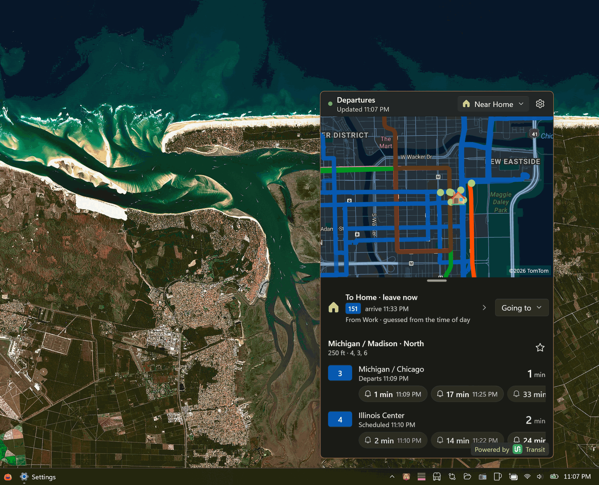

# Tray Times

Click the tray icon for a departures board and a suggested trip, anywhere [Transit](https://transitapp.com) has data. Open the suggestion for every walking and transit leg, or plan somewhere else. Click away to hide the flyout; the app stays in the tray.



- **Launching:** every manual launch opens the departures flyout, even with nothing saved. Launching again opens the running instance's flyout instead of starting another instance. With **Start with Windows** enabled, Windows sign-in launches stay in the tray without opening a window.
- **One departures board:** every open starts at **Near you**, with saved stops within about a kilometer pinned first, followed by the nearest other lines. Each other line direction appears once, at its closest stop; saved stops show the lines you saved, or all routes. Walk times and departures dimmed as too soon to reach apply only at Near you.
- **Jump menu:** pick the place chip to show departures near Home, Work, another saved place, or a saved stop, or choose **All saved stops**. Saved-stop entries show their next departure from the existing batch, without a lookup. Star stops on the board, or add them in Settings by name/code search, the route → direction → stop browser, or the map.
- **Trip suggestion:** at home, the card suggests Work (then School or your first custom place); elsewhere, Home. It counts down when to leave, with route chips, arrival time, and transfers. **Going to** overrides the destination or opens search. With no Home saved, the card offers setup.
- **Trip view:** select the card for the available options, each with its arrival time, total trip time (transfer waits included), and transfers, then the walks, boarding/alighting stops, transfer waits, and ridden route paths on the map, including a walking-only option when offered. First-ride bells use the same tracking as board rows. **Fit** frames the whole trip. Back, Escape, Backspace, or Alt+Left returns to the board without a request; Escape on the board hides the flyout.
- **Destination search:** **Going to → Search for a place…** looks up addresses with Azure Maps and stop names/codes with Transit, only on submit, never while typing. Without an Azure Maps key it explains the limitation and searches stops only. Choosing a result plans a temporary trip; **Save as place** makes it a custom favorite without requesting another plan. Temporary destinations reset on the next opening, and their plans are never written to disk; search queries/results are not logged.
- **Leave at / arrive by:** in the trip view, **Leave now** opens date/time planning. Future options retain their scheduled times and have no tracking chips until within 30 minutes of departure, when their stops join the shared live batch. Arrive-by options are ordered by latest departure. Returning to Leave now restores the held live suggestion. Times share five-minute cache buckets: leave-at rounds up and arrive-by rounds down.
- **Tray tooltip:** the tracked ride comes first, then the suggested trip and as many saved stops near the board's center as fit. Untracked times are cleared when the flyout is hidden.
- **Settings:** a Mica-backed window groups **Your places and stops**, **Ride alerts**, and **App & data** into native cards and expanders. Favorite stops stay open when you have saved stops; otherwise **Add a stop** opens for setup. Places, API usage, and credits expand when needed. Alert, startup, and API-limit preferences apply immediately.
- **Vehicles:** click a departure row to show that route direction's live vehicles on the map, drawn as a bus, train, tram, or ferry to match the line. The row's own trip is highlighted with a larger yellow background, and the map frames it with its stop. A solid arrowhead shows each vehicle's heading once it has moved. Tapping a vehicle shows its label and how crowded it is, when the agency reports that. While a row stays selected its vehicles refresh every minute (only at the Normal call-budget level). Selecting a stop, tapping empty map, or showing all listed stops clears the highlight.
- **Location permission:** the board and suggestion share one Windows location lookup per refresh, without opening a prompt. Without a fix, the board falls back to **Near Home**, then **All saved stops**, then a permission/setup notice; the suggestion guesses from the time of day. Use **Grant Location Permission** to open the permission prompt or location settings. The flyout stays open while you grant access and retries when you return. Jumping to a saved place/stop and viewing All saved stops do not require device location.
- **Departures:** the [Transit API v4](https://api-doc.transitapp.com/v4.html). It merges real-time and timetable departures itself: timetable-only times are labeled "Scheduled" and dimmed, late real-time departures say "4 min late", and a canceled trip is dimmed and marked "Canceled" (later canceled trips are left out of a row's strip).
- **Service alerts:** the agency's alerts for a route (detours, holiday schedules, closed stations, elevator outages) come with its departures, at no extra request. A warning sign under the route's badge, on board rows and trip legs (red when service is suspended), opens each alert's headline, what it does and why, until or from when, and its text. Alerts show while in effect and from a day before they start; they're kept in memory only.
- **Units and language:** distances use meters and kilometers unless Windows' region uses miles. Names and headsigns come in Windows' display language when the agency publishes one.
- **Basemap, address search, and walking times:** Azure Maps, with the map rendered by [WinUIEx.Maps](https://github.com/dotMorten/WinUIEx.Maps). Address search is biased toward your home place, not a fixed city.

The transit code sits behind `ITransitService` (`TrayTimes.Core\Transit\`). The endpoint review is in [the migration plan](docs/transit-app-migration.md); the board/planner design, measured request counts, and acceptance evidence are in [the completed board and trip planner plan](docs/board-and-trip-planner-plan.md). Sign-in is a separate, unstarted phase, planned in [docs/transit-login-feasibility.md](docs/transit-login-feasibility.md).

## Install

Download [TrayTimes.appinstaller](https://github.com/Tray-Land/TrayTimes/releases/latest/download/TrayTimes.appinstaller) and open it. Windows installs the right version for your PC (x64 or ARM64), plus the Windows App Runtime if it's missing, and keeps Tray Times up to date: it checks for a new release when the app starts and in the background.

- Requires Windows 10 1809 (build 17763) or later, x64 or ARM64.
- Installed 1.0.0 from the `.msix` files? Open the `.appinstaller` once. It upgrades the app in place and turns on automatic updates. Favorite places carry over; stops saved by the earlier BusTime version don't (see below).

## Project layout

- `TrayTimes/`: the WinUI 3 app. `Views/` and `Controls/` hold the UI; `Services/` holds code that needs Windows (settings storage, location, the transit cache file, tray placement).
- `TrayTimes.Core/`: plain .NET code with no WinUI or Windows dependencies. `Transit/` has the provider-neutral models, the Transit API client (`TransitApp/`), the call budget, the failure gate, the shared caches, and the request coordinators; `Models/` has the favorite stops and places and the departure snapshots; `Commute/` composes the board, guesses destinations, searches, selects trip options, and retimes every leg from live departures.
- `TrayTimes.Tests/`: MSTest unit tests for `TrayTimes.Core` and the platform-free app services, laid out to mirror them. Use the platform-detected commands below. They use a fake HTTP handler and clock, so they need no API key, network, or package identity.
- **Request diagnostics:** the client's `Diagnostics.Observed` event and bounded `Diagnostics.Snapshot` (last 256 observations) distinguish physical request starts/completions from cache/task reuse and budget or cooldown refusals, with consumer, trigger, duration, outcome, and batch size. Debug builds also emit credential-safe `Transit request` lines to the debugger. The saved Settings tally counts every attempt, including failures.
- **Log file:** `LocalState\logs\tray-times.log` (in the package's folder under `%LOCALAPPDATA%\Packages\`) gets one line per finished Transit call (endpoint, consumer, trigger, outcome, HTTP status, time, batch size) and one line per route whose vehicle feed result changes (`vehicles route=… count=… withTrip=…`; `count=0` means the agency publishes no live positions for it). An unchanged result is logged again only after 15 minutes. The file is capped at 128 KB, then becomes `tray-times.log.old` (replacing the last one), so the log never passes about 256 KB. It never holds the key, URLs, stops, or locations.

## Setup

1. Request a Transit API key at [transitapp.com/partners/apis](https://transitapp.com/partners/apis).
2. In `TrayTimes/`, copy `OAuth.resw.sample` to `OAuth.resw` (it's gitignored), and paste the key into `TransitApiKey`. Optionally, put an Azure Maps key in `AzureMapsKey` for the basemap, address search, and walking times.
3. If your key's limits aren't Transit's free tier (5 calls a minute, 1,500 a month), set them in Settings → Transit API usage.
4. Build, test, and launch with the platform-detected commands below. Use the detached launch so the tray app remains running after the command returns.

## Transit API terms

Using the Transit API means keeping to its terms:

- **Don't share the key.** The key compiled in from `OAuth.resw` is for your own builds. Don't distribute a build containing it (MSIX, Store, or zip) to anyone else.
- **"Powered by Transit"** is shown in the flyout footer (`TimesFlyoutWindow.xaml`, `PoweredByTransit`). It's currently a text link; replace it with Transit's official logo once you have the asset.
- **Before going public,** email apis@transitapp.com at least 10 business days ahead, and answer their requests for integration details or changes.
- **Before publishing** any press release, store listing, or other material that mentions Transit or the API, or uses a Transit trademark, send it to apis@transitapp.com for approval.

The first launch of this version clears favorites saved by the earlier BusTime version (their stop IDs mean nothing to Transit) and starts a new call tally. Favorite places carry over.

### Command-line builds

From the repository root, with the .NET SDK required by `TrayTimes\TrayTimes.csproj` and WinApp CLI installed:

```powershell
$arch = $env:PROCESSOR_ARCHITECTURE
$Platform = if ($arch -eq 'AMD64') { 'x64' } else { $arch }

dotnet build .\TrayTimes\TrayTimes.csproj -c Debug -p:Platform=$Platform
dotnet test .\TrayTimes.Tests\TrayTimes.Tests.csproj -c Debug -p:Platform=$Platform
winapp run .\TrayTimes\TrayTimes.csproj -c Debug --arch $Platform.ToLowerInvariant() -p Platform=$Platform --no-build --detach
```

Keep named controls distinct from properties used by `x:Bind` in data templates. For example, the flyout's `EmptyStateText` control must not be named `EmptyText`, which is a bound `StopGroupItem` property. That collision produces WMC1507 in Visual Studio; the standalone XAML compiler used by CLI builds instead fails with WMC9999 while loading the warning's error-message resource.

### Releases

1. Bump `Identity/@Version` in `TrayTimes\Package.appxmanifest`, then commit and push.
2. From a PowerShell session that has the maintainer's `sign-msix` function, run `.\build-msix-for-gh.ps1`. It builds a signed x64 + ARM64 `.msixbundle` and the `TrayTimes.appinstaller` feed, checks them, and creates a draft GitHub release.
3. Publish the draft as the latest release without changing its tag (the feed's download addresses use it), then run `.\build-msix-for-gh.ps1 -VerifyPublished`.

`.\build-msix-for-gh.ps1 -SkipRelease -NoSign` checks the whole build without signing. The script is a copy of the one in the `winui-tray-app` skill; fix it there, not here.

## API budget

Transit's free tier is **5 calls a minute and 1,500 a month**, about 50 a day. The quota belongs to the key, so every install sharing a key shares it. Everything below exists to stay inside it.

**The call budget.** Every request takes a slot from `TransitBudget` before it's sent. Automatic refreshes leave 2 of each minute's slots for things you do and for tracking, and those wait for a free slot instead of failing. Each day gets an even share of what's left of the month. Below 60% of today's share, the open flyout refreshes every minute. Above it, every 3 minutes. Once today's share is used, times update only when you open the flyout (if they're over 5 minutes old) or refresh. With 2% of the month left, only refreshes and tracking go through; at zero, nothing does. Settings shows the month's total, today's share, and the current level. The tally can't be reset, because the budget relies on it.

**One call per refresh.** Departures for up to 100 stops come back in one `stop_departures` call, shared by the board, saved stops, the suggestion's boarding and transfer stops, near-departure timed trips, and tracking. A new batch waits 750 ms for the other consumers to join. At Normal, a warm open costs one call; reopening within a minute costs none. A cold open adds one `nearby_routes` and one `plan` call, for three total. Opening the trip view, switching options, opening menus, and going Back cost nothing.

**Discovery is cached and kept.** Nearby lines are reused within 150 m for 24 hours; trip plans from about the same origin to the same destination for 3 hours. A jump to an uncached place/stop costs one discovery plus one departures call; cached discovery removes the first, and fresh stop snapshots can remove the second. Changing destinations costs one uncached plan plus 0–1 departures call for newly watched stops. Each distinct time mode/five-minute bucket has its own plan; returning to a cached time or Leave now is free. An infeasible live suggestion is re-planned at most once per 15 minutes.

Area route lists and route details are kept for a week, stop searches for a day. Discovery and saved-place plans persist in `LocalState\transit-cache.json`, so fresh caches survive restarts and the flyout's one-minute teardown. Temporary searched plans and stop searches stay in memory. Live refreshes reuse the trip structure and retime every ride from the shared batch; they do not make another plan call.

**Route lines never cost a call.** Lines are drawn only from shapes that came with calls the app made anyway: route details, nearby lines, trip plans, and a stop's first departures each week, which ask for shapes.

**Vehicles on demand.** Positions are fetched for the selected row's route direction only, not for every listed trip.

**Tracking.** The tracked stop is checked every 3 minutes while the ride is over 10 minutes away or known only from the timetable, every 90 seconds at 5–10 minutes, then every 60 seconds. It switches to every 90 seconds once two separate checks have confirmed the ride is gone, and it slows to half that pace when the budget is tight. A timetable-only ride isn't looked for until 15 minutes before it leaves. The check at the end of the 5-minute grace costs nothing, since no answer could change the outcome. A ride tracked from 15 minutes out costs about 12 calls. Matching uses Transit's trip ID, so it also works on feeds without real-time data, including cancellations.

**Failures and cancellation.** One failure cooldown wraps every call. After a network, timeout, or server failure, timer-driven refreshes make no request for 15 s, doubling to a 5-minute cap on repeated failures; a success resets it, and requests that fail together count once. Held requests report the usual "can't reach" state and are recorded as suppressed in the diagnostics, never as empty results. Manual actions (refresh, F5, reopening the flyout, changing center/destination/stops, picker selections, picking a row) skip that hold but are spaced at least 5 s apart after a failure. Tracking is never delayed by an ordinary cooldown. A 429, or a 503 with `Retry-After`, pauses every request for the server's `Retry-After` (60 s if absent, never more than an hour). A rejected key (HTTP 401/403) pauses timers and tracking for 30 minutes, allowing one manual retry after the 5 s spacing. A rejected query (HTTP 400/404, such as one unknown stop) never starts a cooldown. Closing the flyout or Settings cancels their in-flight requests; a shared load that another consumer still waits on keeps going.

The board and suggestion keep validated discovery during the flyout's one-minute warm lifetime. A quick reopen shows the last rows immediately, and routine refreshes don't wait for a new location or walking route. Location checks repeat discovery only for meaningful movement (over 25 m), changed destinations or places, expired plans, or missing discovery, and the cache makes a fresh repeat within 150 m free. Network polling stops while hidden, except for explicitly tracked rides.
